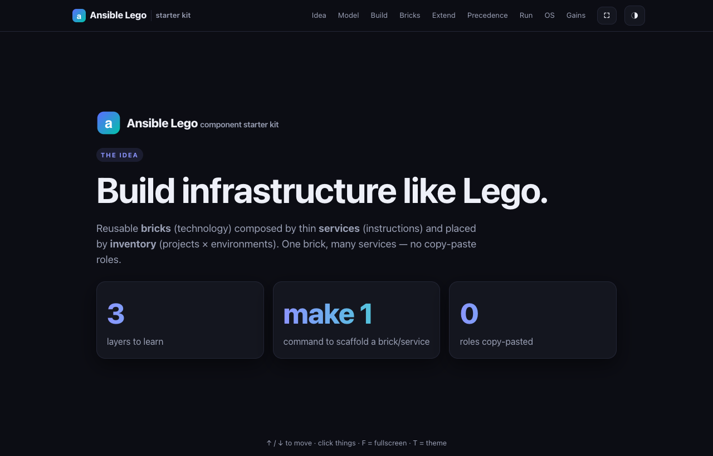

# Ansible "Lego" — a component-based way to work with Ansible

[](https://github.com/henrydominguez-cloud/ansible-lego/actions/workflows/ci.yml)

> **This repository is a concept and a reusable base — not a finished product.**
> It shows a *way of organising Ansible* (the "Lego" approach) so teams stop
> copy-pasting roles and start composing reusable ones. **Read it to learn the
> idea; fork it to build your own platform on top.**

## The idea in one paragraph

Instead of one big role per service (each re-implementing install → configure →
run), you split the work into **three reusable layers**:

- **Bricks** (`roles/components/`) — *one technology each* (nginx, postgres, …).
  Written once, parameterised, **never copied**.
- **Services** (`roles/services/`) — thin *instructions* that **pick** bricks and
  add their own content. They have **no install logic** of their own.
- **Inventory** (`inventory/<project>-<env>/`) — *where* and *how much*: hosts,
  ports, and per-environment values.

Fix a brick once and **every service that uses it inherits the change**. That is
the whole concept — everything else in this repo is a *runnable reference* of it,
with generators, a local test lab, secrets handling and docs so you can adopt the
idea quickly.

[](docs/architecture-presentation.html)

<sub>↑ a self-contained interactive deck — [open it in a browser](docs/architecture-presentation.html) (build-a-service demo, brick catalogue, live precedence demo).</sub>

> ℹ️ **What ships here.** Two example bricks (`nginx`, `postgres`) and two example
> services (`hello-web`, `notes-api`), generators to scaffold your own, a local
> Docker test lab, ansible-vault scaffolding and docs. It is **sanitised**: the
> brand is a placeholder (**ACME**) and the example projects are **Alpha** /
> **Beta** — nothing here is production data or credentials.
>
> **Author:** Henry Domínguez Grullón · **License:** MIT

## The model (three layers)

```
 INVENTORY  inventory/<project>-<env>/     "where & how much": host X, prod, port 8081
     ^ places & tunes
 SERVICES   roles/services/<name>/         "instructions": pick bricks + add content
     ^ composes (meta dependencies)
 BRICKS     roles/components/<name>/       reusable technology (nginx, postgres, ...)
                                            install - configure - run (parameterised)
 resources/  = big shared assets, vendored ONCE (never per role)
```

## Use it as a base

```bash
make new-brick   NAME=myapp     # scaffold a component from skeletons/
make new-service NAME=my-api    # scaffold a service (picks bricks) from skeletons/
```
Full walkthrough with ASCII diagrams, the precedence rules, and how to extend:
**[docs/getting-started.md](docs/getting-started.md)**.

🎬 Prefer visual? Open [docs/architecture-presentation.html](docs/architecture-presentation.html) in a browser — the interactive deck shown above. Use ↑/↓ to move between slides, F for fullscreen.

## Run the examples (local Docker lab, any architecture)

```bash
make deps                       # once: install collections (incl. community.docker)
make lab-up                     # start EL9/EL8 containers with systemd
make lab-run PB=alpha-hello     # 1 brick:  nginx            -> serves :8080
make lab-run PB=alpha-notes     # 2 bricks: nginx + postgres -> serves :8081 + a 'notes' DB
make lab-shell C=rocky9a        # look inside
make lab-down
```
- `hello-web` — the minimal 1-brick service (nginx serving a page).
- `notes-api` — a **multi-brick** service: nginx in front, Postgres behind.

Both are arch-native (EL AppStream), so they install and run for real on Apple
Silicon. See [docs/local-testing.md](docs/local-testing.md).

## What this demonstrates (for reviewers)
- **Deduplication via composition** — bricks reused by services; change once, all inherit.
- **Clean variable precedence** — brick fallbacks that never shadow service knobs;
  per-environment overrides from inventory (a subtle Ansible gotcha, handled on
  purpose — [docs/getting-started.md](docs/getting-started.md) §5).
- **Multi-OS + multi-source** — EL8/EL9 (RHEL/Rocky/Oracle), install from repo, a
  mirror, or local RPMs (air-gapped) — [docs/os-and-install-sources.md](docs/os-and-install-sources.md).
- **Secrets done right** — `ansible-vault` scaffold, nothing sensitive in git,
  a worked example — [docs/secrets-vault.md](docs/secrets-vault.md).
- **Tested locally** — a Docker lab of EL9/EL8 hosts — [docs/local-testing.md](docs/local-testing.md).
- **Generators + skeletons** so extending the base is a one-liner.
- **CI included** — GitHub Actions runs yamllint + ansible-lint (passes the
  *production* profile) + syntax-check on every push / PR (`.github/workflows/ci.yml`).

## Repo layout

```
roles/
  components/   nginx  postgres            <- bricks (add your own)
  services/     hello-web  notes-api       <- instructions (add your own)
skeletons/      component/  service/       <- copy-me templates (make new-*)
inventory/      alpha-prod/  alpha-dev/    <- projects x environments
playbooks/      alpha-*.yml  install-*.yml  site.yml
resources/      shared assets (git-ignored blobs)
lab/            local Docker EL9/EL8 test lab
docs/           getting-started, os-and-install-sources, secrets-vault, local-testing, sparse-checkout
Makefile        convenience wrapper (make help)
```

## The one precedence rule to remember

```
 brick defaults  <  service defaults  <  inventory group_vars  <  service vars/  <  -e
```
A brick's own defaults **shadow** a service's `defaults/` during the brick's run.
So: knobs a service must set go in the service's **`vars/`** (or the brick uses
`{{ knob | default(x) }}`); per-environment knobs stay in `defaults/` and get
their real value from **inventory**. Details + example in
[docs/getting-started.md](docs/getting-started.md).

## Contributing
New bricks & services welcome — see [CONTRIBUTING.md](CONTRIBUTING.md) for the conventions (precedence, tags, secrets, checklists).

## License
MIT — see [LICENSE](LICENSE).
